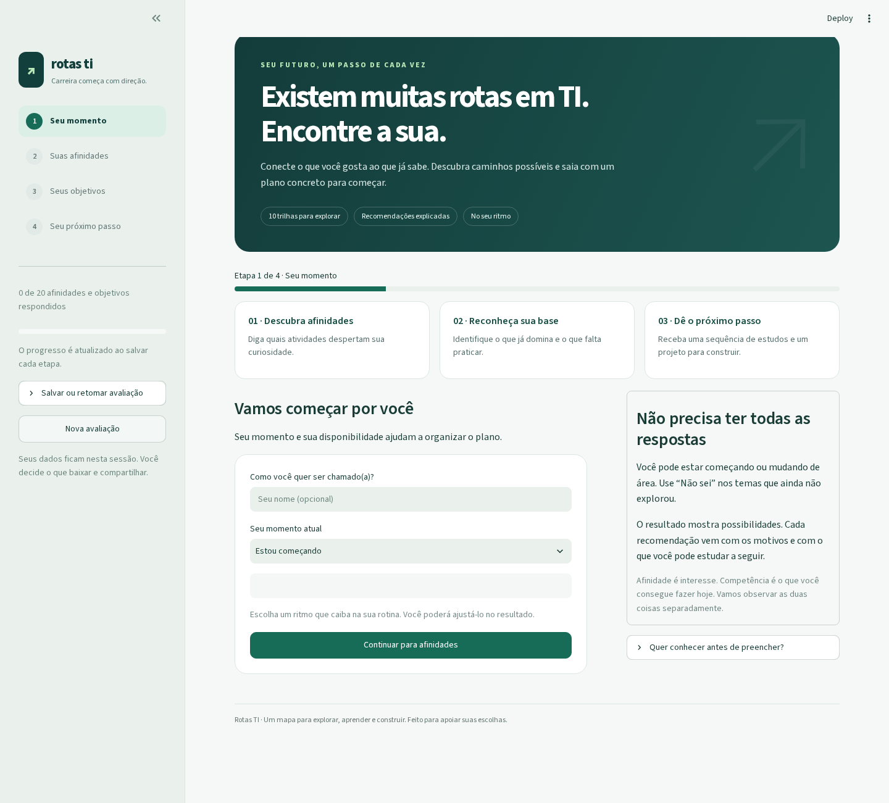
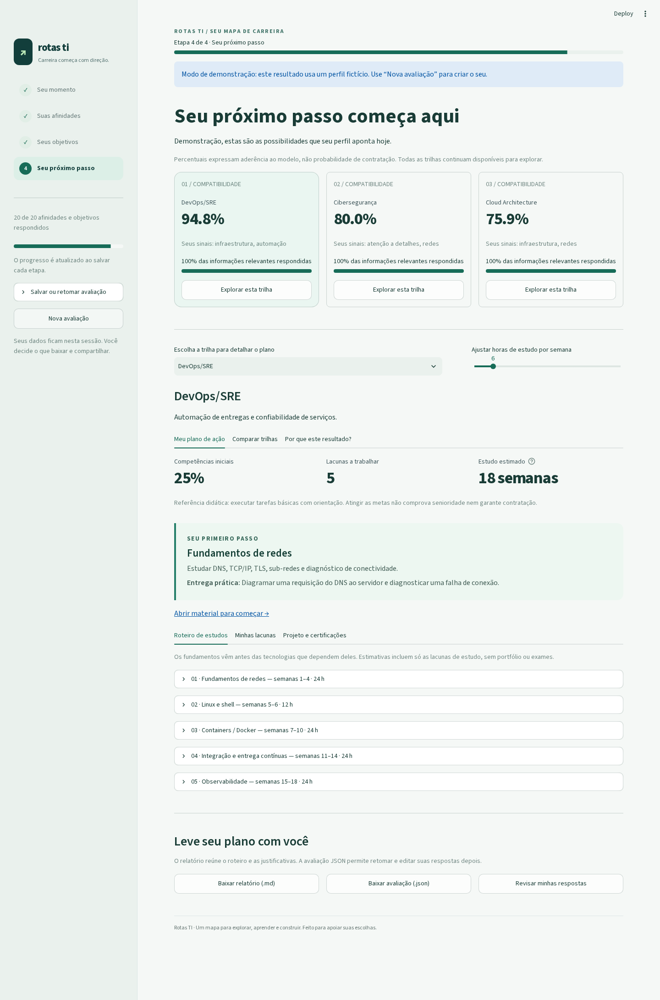

# Rotas TI — Sistema Especialista de Carreiras

Implementação do trabalho **“Sistema Especialista Inteligente para Mapeamento, Compatibilidade e Trilha de Carreira em TI”**, da disciplina Inteligência Artificial, UNIPAC Barbacena, enunciado de 22/10/2026.

O sistema cruza afinidades e objetivos com regras ponderadas, compara dez trilhas e gera um roteiro de estudos a partir das competências atuais. A aplicação e os relatórios estão em português.



## O que a aplicação oferece

- Questionário em etapas, com interesses separados das competências e cinco grupos de autoavaliação.
- Ranking explicável com faixa de variação para respostas desconhecidas.
- Comparação de até três carreiras por afinidade, competências, lacunas e esforço de estudo.
- Plano com primeiro passo destacado, pré-requisitos, entregas práticas e ritmo semanal ajustável.
- Metas de estudo Júnior, Pleno e Sênior, com recálculo das lacunas e orientação de portfólio por nível.
- Salvamento e retomada de avaliações JSON, além de relatório Markdown.
- Três perfis demonstrativos para explorar o resultado sem preencher tudo.



## Executar

Requer Python 3.10 ou superior. Na pasta do projeto:

No Linux/macOS, o atalho prepara o ambiente caso ainda não exista e inicia a aplicação:

```bash
./iniciar.sh
```

Ou execute manualmente:

```bash
python3 -m venv .venv
source .venv/bin/activate
python -m pip install -r requirements.txt
python -m streamlit run app.py
```

Abra **http://localhost:8501**. Para encerrar, pressione `Ctrl+C` no terminal.

Neste ambiente, a `.venv` já foi criada e as dependências foram instaladas. Basta executar:

```bash
.venv/bin/python -m streamlit run app.py
```

No Windows, ative o ambiente com `.venv\Scripts\activate`. A instalação precisa de internet; após instalar as dependências, o cálculo funciona localmente e sem APIs externas. Os links dos materiais de estudo exigem conexão.

Para experimentar apenas o motor, sem instalar Streamlit ou Pandas:

```bash
python3 exemplo.py
```

## Fluxo da aplicação

1. **Perfil pessoal:** nome opcional, momento atual e horas semanais disponíveis.
2. **Afinidades técnicas:** 14 perguntas graduais e autoavaliação de 33 competências.
3. **Objetivos de carreira:** seis perguntas sobre atividades desejadas.
4. **Resultado:** Top 3, gráfico das dez trilhas, matriz de pontuações, justificativas e plano da trilha escolhida.

Na tela final, escolha qualquer trilha para visualizar suas lacunas, ordem de estudo, duração estimada, materiais oficiais, projeto de portfólio e certificações opcionais. Ajuste as horas semanais para recalcular o calendário e use a aba de comparação para avaliar até três caminhos. Cada etapa traz uma entrega prática para demonstrar aprendizagem. Baixe o relatório em Markdown ou a avaliação completa em JSON. É possível voltar às etapas e editar respostas sem perder o que já foi salvo. Alterações em formulários são salvas ao usar seus botões de navegação.

As respostas permanecem na sessão do Streamlit; não há banco de dados nem envio de resultados a serviços externos. Use **Salvar ou retomar avaliação** na barra lateral para baixar o progresso confirmado ou restaurar um arquivo JSON de até 1 MB. A importação valida as entradas e recalcula resultados com a base atual; pontuações contidas no arquivo não são usadas como verdade. Arquivos exportados pela primeira versão também são aceitos. Uma nova sessão ou a opção “Nova avaliação” reinicia o preenchimento.

## Requisitos do enunciado

| Requisito | Implementação |
|---|---|
| Dez trilhas | Back-end, Front-end/UX, Cientista de Dados, Engenheiro de Dados, Cibersegurança, DevOps/SRE, Cloud Architecture, Mobile, QA e Product Management |
| Respostas graduais | Escala Likert de 1 a 5 e opção “Não sei” |
| Regras e pesos externos | `regras_carreiras.json`, carregado e validado dinamicamente |
| Inferência e incerteza | Soma ponderada normalizada, cobertura da informação e regras de penalidade |
| Ranking e Top 3 | Compatibilidade individual de 0% a 100% para todas as trilhas |
| Explicabilidade | Contribuições por pergunta, pesos e motivos das penalidades |
| Metas Júnior e lacunas | Níveis de competência de 0 a 4 comparados às metas por trilha |
| Níveis de senioridade | Júnior como padrão; metas didáticas Pleno e Sênior selecionáveis, definidas no JSON |
| Roadmap individual | Apenas competências faltantes, respeitando pré-requisitos e disponibilidade semanal |
| Certificações e portfólio | Sugestões por trilha, links oficiais e foco de prática nas lacunas |
| Interface Streamlit | Wizard com três etapas de coleta e página de resultados |
| Visualizações | Gráfico de barras, métricas e tabelas Pandas |
| Robustez | Testes do motor e da interface, incluindo empates e perfil misto dados/web |

## Organização

```text
app.py                     Entrada da aplicação e carregamento da base
regras_carreiras.json       Perguntas, pesos, penalidades, competências e trilhas
career/engine.py            Validação, inferência, roadmap e exportação
career/assessment.py        Salvamento e validação de avaliações importadas
career/ui.py                Páginas e navegação Streamlit
career/charts.py            Gráficos Altair com escala fixa e comparação
assets/style.css            Identidade visual e ajustes responsivos
data/perfis_exemplo.json    Três perfis fictícios para demonstração
exemplo.py                 Demonstração em terminal, sem dependências externas
tests/test_engine.py        Testes de regras e casos limite
tests/test_app.py           Testes de navegação com Streamlit AppTest
tests/test_assessment.py    Testes de importação e compatibilidade de arquivos
scripts/check_browser.py   Fluxo real de navegador, downloads e screenshots
iniciar.sh                 Atalho de execução para Linux/macOS
docs/RELATORIO_TECNICO.md    Método, arquitetura, decisões e limitações
docs/MATRIZ_PESOS.md        Matriz das correlações usadas pelo motor
docs/EXEMPLO_RESULTADO.md   Relatório gerado pelo perfil demonstrativo
requirements.txt           Dependências da aplicação
requirements-dev.txt       Dependências para testes
```

## Testar

```bash
source .venv/bin/activate
python -m pip install -r requirements-dev.txt
python -m pytest -q
```

Também é possível executar somente o motor com `python -m pytest tests/test_engine.py -q`. Os testes da interface usam a ferramenta oficial `streamlit.testing.v1.AppTest`, sem exigir navegador. Eles não substituem uma inspeção visual em navegador.

Para executar a verificação adicional de navegador, mantenha a aplicação aberta em outro terminal:

```bash
python -m pip install -r requirements-browser.txt
python -m playwright install chromium
python scripts/check_browser.py
```

Esse teste verifica desktop e celular, comparação, downloads reais de Markdown/JSON e restauração de uma avaliação. Salva capturas em `docs/images`. Use `--url http://127.0.0.1:8502` para outra porta. Playwright não é necessário para usar a aplicação nem para a suíte principal.

## Modelo de pontuação

Para cada resposta conhecida `r`, a afinidade normalizada é `n = (r − 1) / 4`. O valor 1 corresponde a 0; o valor 5 corresponde a 1. Para “Não sei”, usa-se 0,5 e a pergunta não conta como evidência respondida.

```text
base(trilha) = 100 × soma(peso × afinidade_normalizada) / soma(pesos)
compatibilidade = limitar(base − soma(penalidades_ativadas), 0, 100)
```

Cada trilha tem duas regras críticas: uma resposta conhecida menor ou igual a 2 ativa uma penalidade de 12 pontos percentuais. Condições e valores estão no JSON; o motor também suporta condições conjuntas e limiares `gte`. Respostas desconhecidas não ativam penalidades.

Trilhas até três pontos percentuais do primeiro lugar são apresentadas como resultados próximos. Empates exatos usam o identificador da trilha para manter a ordem estável. Se menos de 50% das perguntas globais ou do peso das perguntas da primeira trilha tiverem respostas conhecidas, o resultado é sinalizado como provisório. Uma melhor pontuação abaixo de 40% recebe aviso de baixa compatibilidade.

Os percentuais das trilhas são independentes, não somam 100% e não representam probabilidade de contratação. Horas disponíveis alteram o calendário; conhecimento atual altera as lacunas; afinidades e objetivos alteram o ranking.

Para respostas pendentes, o motor também calcula limites conservadores: no inferior, considera contribuição desconhecida mínima e todas as penalidades ainda possíveis; no superior, contribuição máxima e apenas penalidades já confirmadas. A faixa contém os resultados possíveis, mas pode ser mais larga que a faixa exata quando regras interagem. Não é um intervalo de confiança estatístico. Com todas as respostas conhecidas, os limites coincidem com a pontuação.

## Conhecimento e senioridade

| Nível | Interpretação |
|---|---|
| 0 | Nunca estudei |
| 1 | Conheço a teoria |
| 2 | Faço tarefas básicas com orientação |
| 3 | Realizo projetos com autonomia |
| 4 | Aprofundo, otimizo e oriento |

A meta Júnior desta base é o nível 2 nas competências exigidas. Na tela de resultados, **Meta de senioridade para os estudos** permite escolher também Pleno (mínimo 3) ou Sênior (mínimo 4). O motor aplica `max(meta da competência, piso do nível)` e recalcula lacunas, cobertura, cronograma e orientação do portfólio. Ranking de afinidades permanece independente dessa escolha. A meta é preservada na revisão e nas exportações; avaliações antigas assumem Júnior.

As três referências são educacionais e usam o mesmo catálogo de competências: orientação, autonomia e aprofundamento. Não constituem uma avaliação completa dos requisitos profissionais de cada cargo. O sistema indica metas de estudo atendidas; não atribui senioridade profissional pela autoavaliação. As regras e os textos estão em `seniority_levels` no JSON (base 1.2.0, esquema 2).

Se o usuário declara domínio de uma tecnologia sem os fundamentos exigidos, o plano sinaliza essa inconsistência para revisão, mantendo os valores informados. O roteiro respeita também pré-requisitos indiretos: HTML/CSS pendente vem antes de React mesmo quando JavaScript já foi declarado dominado. As entregas práticas ajudam a conferir a autoavaliação com evidências.

## Alterar a base de conhecimento

Edite `regras_carreiras.json`. Os pesos são não negativos, e sua soma em cada trilha deve ser positiva. Identificadores de perguntas, competências e pré-requisitos precisam existir. Pré-requisitos devem estar entre os requisitos da trilha e não podem formar ciclos. A validação acusa problemas antes de exibir o questionário. Veja a especificação no [relatório técnico](docs/RELATORIO_TECNICO.md).

## Entrega e GitHub

O projeto está versionado e publicado em [possagabriel/Trabalho-IA-SegundaEtapa](https://github.com/possagabriel/Trabalho-IA-SegundaEtapa), branch `main`. `.venv`, caches e segredos são ignorados; o repositório contém apenas os arquivos do projeto.

## Referências

O método é uma modelagem didática própria. As fontes abaixo orientam o uso das ferramentas e as sugestões de estudo; **não validam os pesos, limiares ou metas definidos para este exercício**.

- [Streamlit: formulários e submissão em lote](https://docs.streamlit.io/develop/api-reference/execution-flow/st.form).
- [Streamlit: gráficos Altair](https://docs.streamlit.io/develop/api-reference/charts/st.altair_chart), [upload de arquivos](https://docs.streamlit.io/develop/api-reference/widgets/st.file_uploader) e [containers](https://docs.streamlit.io/develop/api-reference/layout/st.container).
- [GitHub: certificações](https://learn.github.com/certifications).
- [AWS: Solutions Architect – Associate](https://aws.amazon.com/certification/certified-solutions-architect-associate/), [Data Engineer – Associate](https://aws.amazon.com/certification/certified-data-engineer-associate/) e [AI Practitioner](https://aws.amazon.com/certification/certified-ai-practitioner/).
- [ISC2: Certified in Cybersecurity](https://www.isc2.org/certifications/cc).
- [ISTQB: Certified Tester Foundation Level](https://istqb.org/certifications/certified-tester-foundation-level-ctfl-v4-0/).
- [Scrum.org: Professional Scrum Product Owner I](https://www.scrum.org/assessments/professional-scrum-product-owner-i-certification).
- [Linux Foundation: Certified Kubernetes Administrator](https://training.linuxfoundation.org/certification/certified-kubernetes-administrator-cka/).

Os links das certificações foram consultados em 22/10/2026. Os exames são opcionais e podem ter custo; consulte a página oficial antes de se inscrever. Outros materiais oficiais estão associados a cada competência no JSON.
