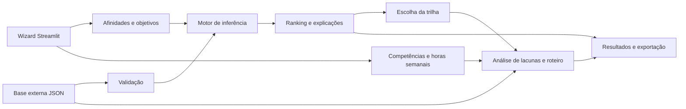

# Relatório técnico — Rotas TI

**Disciplina:** Inteligência Artificial  
**Curso:** Ciência da Computação — UNIPAC Barbacena  
**Professor:** Felipe Roncalli de Paula Carneiro  
**Enunciado:** Trabalho Etapa 2, de 22/10/2026

## 1. Objetivo e escopo

Construir um sistema especialista baseado em regras com tratamento de incerteza e pontuação ponderada. O sistema avalia dez trilhas de TI e produz uma orientação explicável, acompanhada de lacunas de competência e ações concretas de desenvolvimento.

As trilhas são Back-end, Front-end/UX, Cientista de Dados, Engenheiro de Dados, Cibersegurança, DevOps/SRE, Cloud Architecture, Mobile, QA e Product Management. O alvo de competência é uma referência inicial Júnior. Não se infere senioridade profissional a partir de afinidade.

## 2. Arquitetura



O motor usa somente a biblioteca padrão do Python e pode ser executado independentemente. Streamlit controla a interação; Pandas organiza tabelas e o gráfico. A base JSON contém todo o conhecimento de domínio. Não foi necessário usar Experta porque o enunciado também permite um motor próprio de soma ponderada.

## 3. Fase 1 — Engenharia do conhecimento

Foram definidas 20 perguntas: 14 afinidades técnicas e seis preferências de atuação. As respostas conhecidas usam uma escala Likert de 1 a 5. A opção desconhecida é representada por `null`, distinguindo ausência de informação de baixa afinidade.

O catálogo tem 33 competências, compartilhadas entre trilhas, evitando perguntar repetidamente o nível do usuário em Git, SQL ou programação. Cada competência tem descrição, pré-requisitos, estimativa de horas por nível e fonte de estudo. Cada trilha reúne pesos, penalidades, metas, certificações e projeto.

Os pesos de 1 a 5 representam relevância relativa dentro da trilha: 5 para atividades centrais; 3–4 para competências de forte apoio; 1–2 para aspectos complementares. Perguntas ausentes do mapa de pesos contribuem zero. A [matriz de pesos](MATRIZ_PESOS.md) permite revisar a modelagem.

Exemplos: matemática e análise de dados têm peso 5 em Ciência de Dados; design e empatia têm peso 5 em Front-end/UX; infraestrutura e automação têm peso 5 em DevOps/SRE. Cada trilha também possui dois fatores críticos que, com resposta baixa, ativam penalidades.

Esta é uma base heurística construída para o exercício, sem entrevistas com especialistas nem calibração empírica. Isso é declarado nos metadados e nos resultados. Recomendações e fontes oficiais não são evidência de validade dos pesos adotados.

### Estrutura do JSON

| Campo | Conteúdo |
|---|---|
| `schema_version` | Versão estrutural aceita pelo carregador |
| `metadata` | Identificação, versão, data e limitações do modelo |
| `scoring` | Escala, neutralidade, cobertura mínima e limiares |
| `knowledge_levels` | Interpretação dos níveis de competência |
| `questions` | Identificador, rótulo, pergunta e grupo |
| `skills` | Competências, pré-requisitos, esforço e materiais |
| `tracks[].weights` | Relação entre perguntas e pesos |
| `tracks[].penalties` | Condições SE–ENTÃO, pontos e justificativas |
| `tracks[].requirements` | Metas e importância de cada competência |
| `tracks[].certifications` | Certificações opcionais e momento sugerido |
| `tracks[].portfolio` | Projeto, descrição e entregáveis |

O carregador valida referências, duplicidades, soma de pesos, faixas numéricas e ciclos de pré-requisitos. Novas regras e trilhas podem ser adicionadas sem alterar as funções de inferência, desde que respeitem a estrutura.

## 4. Fase 2 — Inferência ponderada e incerteza

Para resposta conhecida `rᵢ`, define-se `nᵢ = (rᵢ − 1) / 4`. Para resposta desconhecida, `nᵢ = 0,5`.

```text
Bₜ = 100 × Σ(wₜᵢ × nᵢ) / Σ(wₜᵢ)
Cₜ = max(0, min(100, Bₜ − Σ(penalidades ativadas)))
```

As penalidades são regras declarativas com uma ou mais condições ligadas por E lógico. O motor suporta `lte` (menor ou igual) e `gte` (maior ou igual). Na base inicial, cada trilha tem duas regras de 12 pontos para afinidade até 2 em fatores críticos. Uma condição desconhecida impede a ativação da regra.

Exemplo: em Back-end, a soma dos pesos é 26. Se todas as respostas forem 3, a base será 50%. Se programação for alterada para 1, seu peso 5 passa a contribuir zero: a base será `100 × 21 × 0,5 / 26 = 40,3846%`. A penalidade de 12 pontos resulta em `28,3846%`. Esse cálculo é verificado por teste independente.

A explicação mostra a resposta, o peso e a contribuição de cada pergunta, além das penalidades ativadas. Mantém-se precisão interna; arredondamento é feito somente para exibição.

### Informação incompleta e empates

A cobertura por trilha é a proporção do peso associada a respostas conhecidas. Também se calcula a proporção de perguntas globalmente respondidas. A recomendação é provisória se a cobertura global ou a da primeira trilha ficar abaixo de 50%.

Se todas as respostas forem desconhecidas, todas as trilhas recebem 50%, com cobertura zero e aviso de informação insuficiente. Se todas forem 3, todas recebem 50% com cobertura total e aviso de empate. Esses dois resultados têm o mesmo valor numérico, mas interpretações diferentes.

Trilhas até três pontos da primeira são consideradas próximas. O identificador é o critério determinístico para empates exatos, sem afirmar superioridade substantiva. Se a maior aderência ficar abaixo de 40%, há indicação de baixa compatibilidade geral.

Os valores não são probabilidades. O tratamento de incerteza adotado é gradual e heurístico; não se apresenta como inferência bayesiana ou fator de certeza estatisticamente calibrado.

## 5. Fase 3 — Lacunas e roteiro

O nível atual vai de 0 a 4. Para a referência Júnior, a base inicial exige nível 2: realizar tarefas básicas com orientação. A lacuna de uma competência é `max(0, meta − nível atual)`.

A cobertura de competências é:

```text
100 × Σ(min(nível atual, meta) × importância) / Σ(meta × importância)
```

Conhecimento excedente em uma habilidade não compensa a falta de outra. A ausência de lacunas produz “Metas iniciais atendidas”, sem atribuir senioridade superior.

O roteiro usa uma ordenação topológica: primeiro seleciona lacunas cujos pré-requisitos não estão pendentes; entre essas, escolhe a maior prioridade, calculada por `lacuna × importância`. Empates usam o identificador da competência. Competências já dominadas não geram etapas de estudo.

Cada etapa demanda `lacuna × horas por nível`. O calendário divide o esforço acumulado pela disponibilidade semanal e permite que duas etapas compartilhem a mesma semana. A soma corresponde apenas aos estudos faltantes; projeto e exames têm esforço adicional não estimado.

Cada trilha tem um projeto com entregáveis. A lista de competências faltantes torna explícito o foco de prática individual. Certificações são alternativas opcionais, algumas posteriores ao nível inicial. Por exemplo, CKA requer estudo posterior de Kubernetes; PSPO I trata de Product Ownership e não cobre toda a atuação em Product Management.

## 6. Fase 4 — Interface

O wizard mantém perfil, respostas e competências em `st.session_state`, separados das chaves transitórias dos widgets. Cada formulário grava seus dados tanto ao avançar quanto ao voltar. Isso permite revisar o perfil sem perder as avaliações anteriores.

Os resultados incluem Top 3, gráfico horizontal, tabela comparativa, seleção de qualquer trilha, decomposição do cálculo, lacunas, roteiro, projeto e certificados opcionais. Há exportações Markdown e JSON. O JSON contém as entradas e saídas necessárias para auditar a avaliação.

Não há persistência em banco nem criação automática de repositórios GitHub. O GitHub aparece como destino sugerido para o portfólio. O uso da aplicação não depende de serviços pagos.

## 7. Fase 5 — Verificação

A suíte cobre os seguintes cenários:

| Cenário | Verificação |
|---|---|
| Cálculo conhecido | Soma ponderada e penalidade conferidas numericamente |
| Respostas mínimas e máximas | Pontuações contidas em 0–100 |
| Perfil neutro | Empate estável entre as dez trilhas |
| Perfil desconhecido | Neutralidade, cobertura zero e resultado provisório |
| Perfil misto dados/web | Ambas as áreas com alta aderência e alternativas próximas |
| Perfil de infraestrutura | DevOps/SRE na primeira posição |
| Competências parciais | Redução coerente das lacunas e das horas |
| Competências completas | Roteiro vazio e nenhuma senioridade inventada |
| Disponibilidade diferente | Calendário muda sem alterar conteúdo de estudo |
| Pré-requisitos | Ordem respeitada para todas as trilhas |
| Entradas inválidas | Rejeição de valores fora da escala, NaN, infinito e identificadores inexistentes |
| Base inválida | Detecção de ciclos, pesos nulos e referências quebradas |
| Mudança externa nas regras | Alteração no JSON modifica o resultado do motor |
| Wizard | Fluxo completo, navegação de retorno, persistência e reinício |
| Exploração | Troca de trilha e disponibilização das exportações |

Execute `python -m pytest -q` para obter o resultado no ambiente utilizado. Os testes da interface usam AppTest; não simulam cliques de download em um navegador real.

## 8. Demonstração sugerida

1. Execute `python exemplo.py` para mostrar uma avaliação reproduzível de infraestrutura.
2. Abra o Streamlit e preencha um perfil com preferências altas para dados e desenvolvimento web.
3. Mostre que o ranking permite resultados próximos e explique uma contribuição ponderada.
4. Selecione uma trilha alternativa e compare as lacunas.
5. Aumente uma competência já estudada e observe a redução do roteiro.
6. Baixe o relatório, execute os testes e mostre que os pesos são externos.

O [relatório demonstrativo](EXEMPLO_RESULTADO.md) foi produzido pelo próprio motor, sem edição dos resultados.

## 9. Limitações e evolução

A autoavaliação pode subestimar ou superestimar conhecimentos. As metas de entrada variam entre empresas, e algumas trilhas, como arquitetura de nuvem, frequentemente requerem trajetória prévia. As horas de estudo são estimativas didáticas. A soma de pesos não modela todas as interações entre preferências, e a neutralidade imputada pode aproximar perfis incompletos.

Uma evolução seria revisar a base com profissionais de cada área, realizar avaliação prática de competências, testar sensibilidade dos pesos e comparar recomendações com avaliações independentes. Tais validações não foram realizadas neste trabalho.

As referências oficiais e os links consultados estão no [README](../README.md) e na base de conhecimento.
